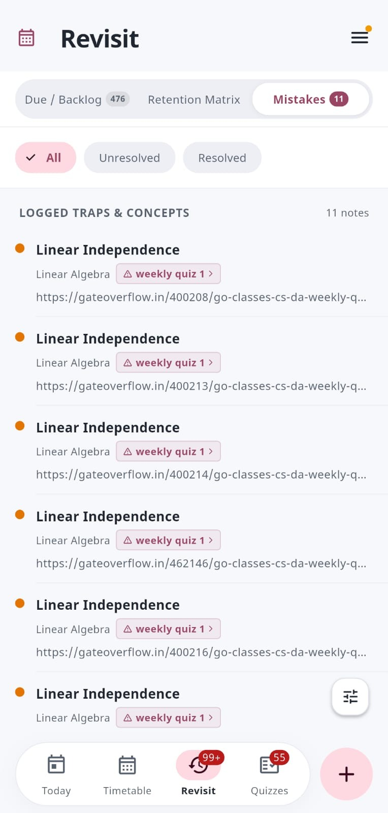
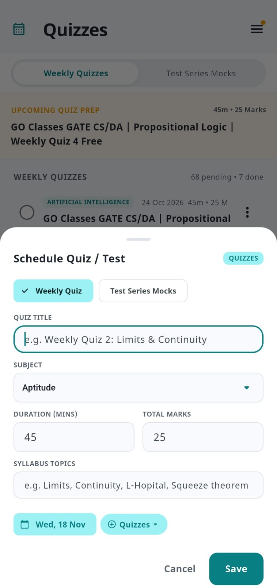
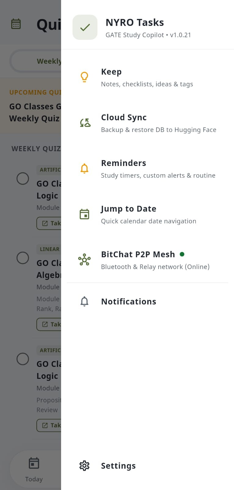
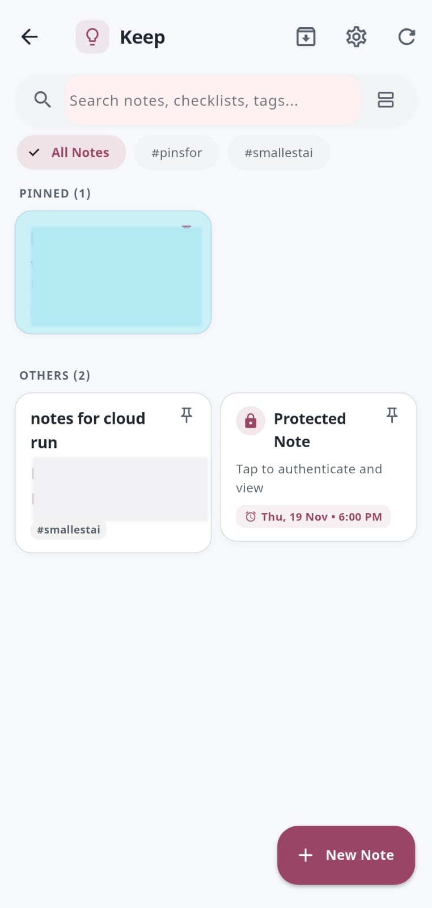

  

# Prepdesk

Prepdesk is an Android study planner for GATE preparation. Plan lectures, revisit material on a schedule, and turn past mistakes into a checklist for your next test.

[Download the Android APK](https://github.com/Ragu-123/nyro-tasks/releases/latest) · [Build history](https://github.com/Ragu-123/nyro-tasks/actions/workflows/build_apk.yml)

## See it in use

| Today | Mistake notebook | Quizzes |
| :---: | :---: | :---: |
|  |  |  |

More screens

| Schedule a test | Navigation | Notes |
| :---: | :---: | :---: |
|  |  |  |

| Reminders | Backup and restore | Desktop Companion |
| :---: | :---: | :---: |
|  |  |  |

These screenshots show an earlier build of Prepdesk. Private details are obscured. Edit and delete now sit in the three-dot menu inside the lecture or quiz detail sheet.

## Study features

| Area | What you can do |
| --- | --- |
| **Today and Timetable** | Check watched hours, see what is due, and browse lectures by subject. Tap a lecture for its details. |
| **Revisits** | Work through due and overdue material. Lectures created in Prepdesk generate spaced recall checkpoints at 1, 4, 7, 14, and 30 days. |
| **Quizzes and test series** | Schedule weekly quizzes and mock tests, open their links, and review saved mistakes relevant to the subject, module, or syllabus. |
| **Mistake notebook** | Record the question, your answer, the correction, why you missed it, and the takeaway. Mark mistakes resolved as you improve. |
| **Keep notes** | Write notes and checklists, add tags and reminders, and protect selected notes with a PIN or an explicit biometric unlock. |
| **Reminders** | Set single or recurring reminders, add checkpoints, and choose notification banners or ringing alarms with snooze controls. |
| **Desktop Companion** | Pair a browser on the same network to read and edit regular notes and log mistakes. Protected notes stay on the phone. |
| **Appearance and backup** | Choose adaptive accents or a fixed theme. Back up and restore the database through a configured Hugging Face Hub account. |

## Install and get started

1. Open the [latest release](https://github.com/Ragu-123/nyro-tasks/releases/latest) and download `app-release.apk`. The release also includes `SHA256SUMS.txt` and a Play build in Android App Bundle format.
2. Open **Today** to see your study day. Use the plus button to add an entry for the section you’re in. Open **Timetable** to browse the wider schedule.
3. Open **Settings → Reminders & Routine** if you want system notifications or ringing alarms. Android controls the permissions for each alert type.
4. To pair a browser, open **Settings → Desktop Companion Studio**, start the local server, and use the address and pairing code shown on your phone.

## Development

The app uses Flutter and Dart for the interface, SQLite for local study data, Kotlin for native Android alarms and notification controls, and HTML, CSS, and JavaScript for Desktop Companion.

| Path | Responsibility |
| --- | --- |
| `lib/pages/` and `lib/widgets/` | Navigation, study screens, settings, and shared controls |
| `lib/data/` | SQLite storage, migrations, and study models |
| `lib/services/` | Notifications, desktop pairing, vault credentials, and backups |
| `android/app/src/main/` | Android manifest, launcher and splash resources, and alarm code |
| `test/` | Regression tests for study flows, reminders, and privacy |
| `images/demo/` | Reviewed screenshots used in this README |

[GitHub Actions](https://github.com/Ragu-123/nyro-tasks/actions/workflows/build_apk.yml) runs Flutter analysis and tests, then builds the GitHub APK and Play bundle. Version tags publish both packages and their checksums to [GitHub Releases](https://github.com/Ragu-123/nyro-tasks/releases). Local source checks and agent instructions are documented in [AGENTS.md](AGENTS.md).
