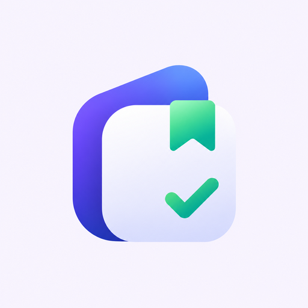
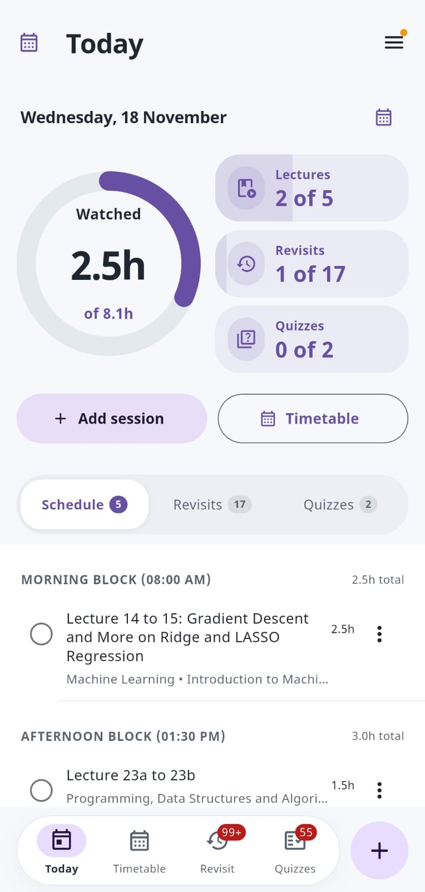
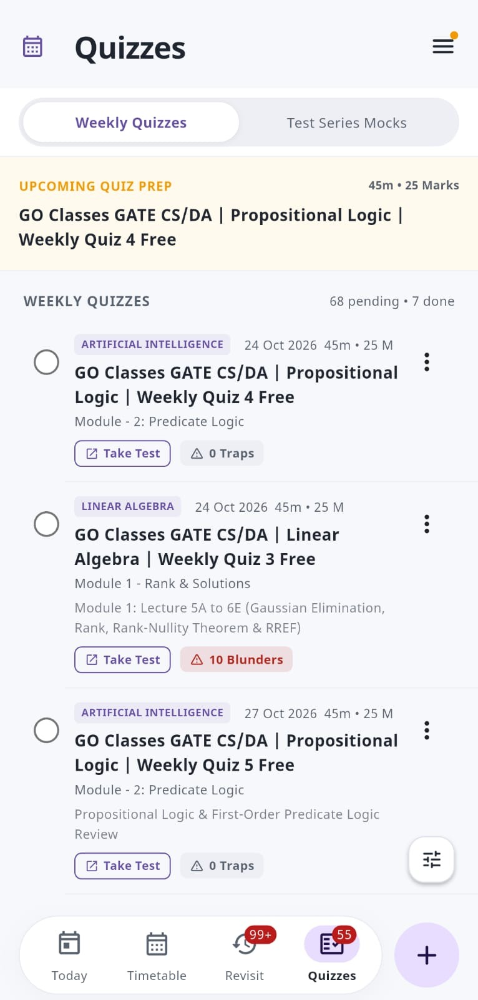
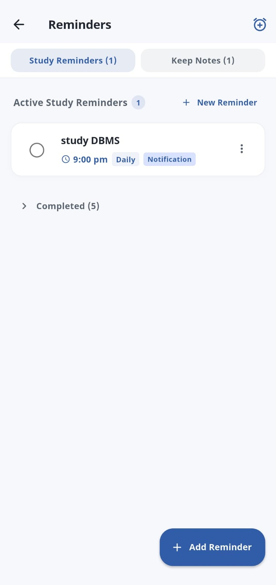
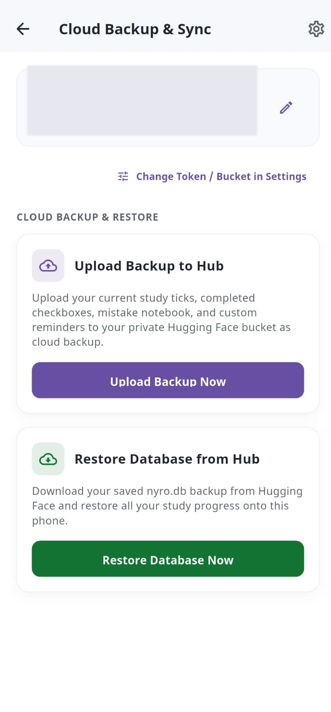
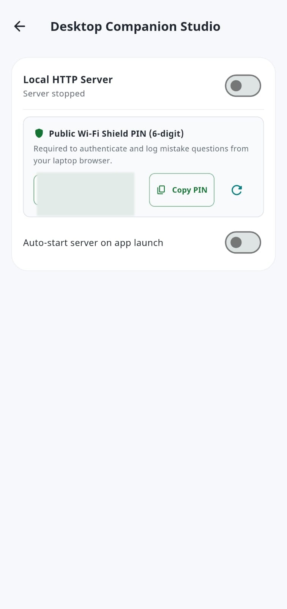

  

# Prepdesk

Prepdesk is an Android study planner for exam preparation. Plan lectures, revisit material on a schedule, review past mistakes, and study with a partner in PrepChat.

[Download the Android APK](https://github.com/Ragu-123/nyro-tasks/releases/latest) · [Build history](https://github.com/Ragu-123/nyro-tasks/actions/workflows/build_apk.yml)

## See it in use

| Today | Mistake notebook | Quizzes |
| :---: | :---: | :---: |
|  |  |  |

More screens

| Schedule a test | Navigation | Notes |
| :---: | :---: | :---: |
|  |  |  |

| Reminders | Backup and restore | Desktop Companion |
| :---: | :---: | :---: |
|  |  |  |

These screenshots show an earlier build of Prepdesk. Private details are obscured. Edit and delete now sit in the three-dot menu inside the lecture or quiz detail sheet.

## Study features

| Area | What you can do |
| --- | --- |
| **Today and Timetable** | Check watched hours, see what is due, and browse lectures by subject. Tap a lecture for its details. |
| **Revisits** | Work through due and overdue material. Lectures created in Prepdesk generate spaced recall checkpoints at 1, 4, 7, 14, and 30 days. |
| **Quizzes and test series** | Schedule weekly quizzes and mock tests, open their links, and review saved mistakes relevant to the subject, module, or syllabus. |
| **Mistake notebook** | Record the question, your answer, the correction, why you missed it, and the takeaway. Mark mistakes resolved as you improve. |
| **Keep notes** | Write notes and checklists, add tags and reminders, and protect selected notes with a PIN or an explicit biometric unlock. |
| **Reminders** | Set single or recurring reminders, add checkpoints, and choose notification banners or ringing alarms with snooze controls. |
| **PrepChat** | Chat nearby or through private relays, share a schedule, and follow a study partner’s day in Blend. |
| **Desktop Companion** | Pair a browser on the same network to read and edit regular notes and log mistakes. Protected notes stay on the phone. |
| **Appearance and backup** | Choose adaptive accents or a fixed theme. Back up and restore the database through a configured Hugging Face Hub account. |

## PrepChat and Blend

Open **PrepChat** from the side drawer for nearby messaging, encrypted private conversations, and study check-ins. Tap the PrepChat logo to open its settings. Use QR verification to confirm a partner’s identity before starting a Blend.

- **Share a schedule.** Choose **Share schedule** in Timetable or in a private chat. Pick the days and study items, preview the card, and send it. The card is a snapshot of your selection.
- **Start a Blend.** Tap the overlapping-circles icon beside the star in a private chat. Find active Blends and invitations under Conversations and People in PrepChat’s Network. In timetable mode, each person manages their own schedule and can share completion and what’s left.
- **Use a shared checklist.** The owner sets the tasks. Each participating partner marks their own progress.
- **Watch only.** Choose this role in either mode or type `/spectate` in a private chat. You can see the approved plan and request fresh progress while keeping your own schedule and completion private.
- **Choose when to update.** Open the PrepChat logo, then **Settings → Blend settings** to manage sharing for each session. Manual updates show a preview. Automatic updates run around the chosen daily time or when a partner requests one. Enable **Keep PrepChat listening** for background updates.

Use the offline sharing section in PrepChat settings to prepare the signed Prepdesk APK or share it over a local hotspot.

Both partners need a version with Blend support. Updates can travel over Bluetooth or through private relays when both partners have starred each other and the relay route is available. Offline updates remain queued, and Blend shows when your partner’s last update arrived. Only the study fields you approve are shared.

## Install and get started

1. Open the [latest release](https://github.com/Ragu-123/nyro-tasks/releases/latest). Choose `prepdesk-arm64-v8a.apk` for ARM64 phones, `prepdesk-x86_64.apk` for x86-64 devices, or `app-release.apk` if you need the universal 64-bit file. The release includes checksums and a Play bundle.
2. Open **Today** to see your study day. Use the plus button to add an entry for the section you’re in. Open **Timetable** to browse the wider schedule.
3. Open **Settings → Reminders & Routine** if you want system notifications or ringing alarms. Android controls the permissions for each alert type.
4. To pair a browser, open **Settings → Desktop Companion Studio**, start the local server, and use the address and pairing code shown on your phone.

## Development

The app uses Flutter and Dart for the main interface, SQLite for local study data, Kotlin and Jetpack Compose for PrepChat, and HTML, CSS, and JavaScript for Desktop Companion.

| Path | Responsibility |
| --- | --- |
| `lib/pages/` and `lib/widgets/` | Navigation, study screens, settings, and shared controls |
| `lib/data/` | SQLite storage, migrations, and study models |
| `lib/services/` | Notifications, desktop pairing, vault credentials, and backups |
| `android/app/src/main/` | Android manifest, launcher and splash resources, and alarm code |
| `android/bitchat/` | PrepChat interface, private messaging transports, and Blend features |
| `test/` | Regression tests for study flows, reminders, and privacy |
| `images/demo/` | Reviewed screenshots used in this README |

GitHub Actions runs Flutter checks and PrepChat packet tests and builds the APKs and Play bundle on `pre-prod`. After merge, the release tag publishes those same packages and checksums. [Workflow](https://github.com/Ragu-123/nyro-tasks/actions/workflows/build_apk.yml) · [Releases](https://github.com/Ragu-123/nyro-tasks/releases) · [Agent guide](AGENTS.md)

Prepdesk is distributed under the [GNU General Public License v3.0](LICENSE). The [BitChat integration notes](docs/BITCHAT_ANDROID_INTEGRATION.md) record the upstream revision and the changes for Prepdesk.

Thanks to the [BitChat Android contributors](https://github.com/permissionlesstech/bitchat-android) for the mesh transport, private messaging, and native chat interface that Prepdesk builds on.

See [Contributing](CONTRIBUTING.md) for the pull request and release process.
